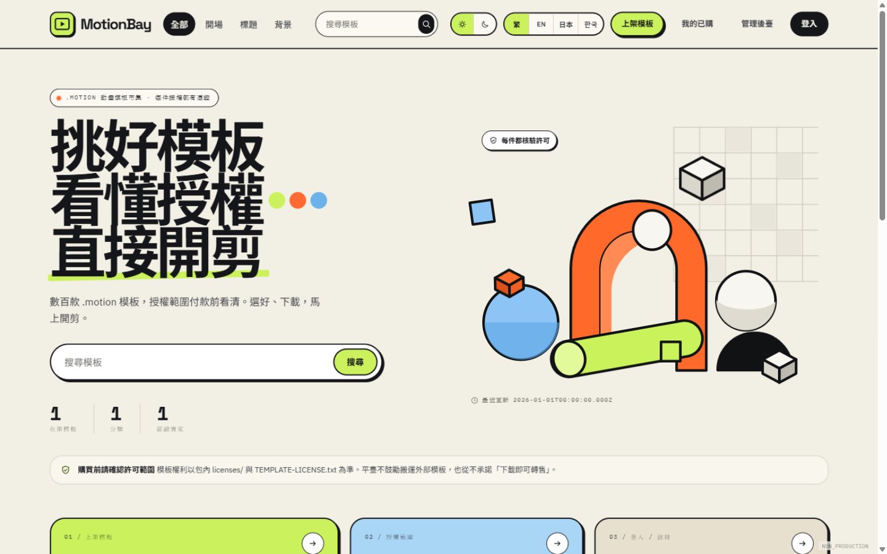
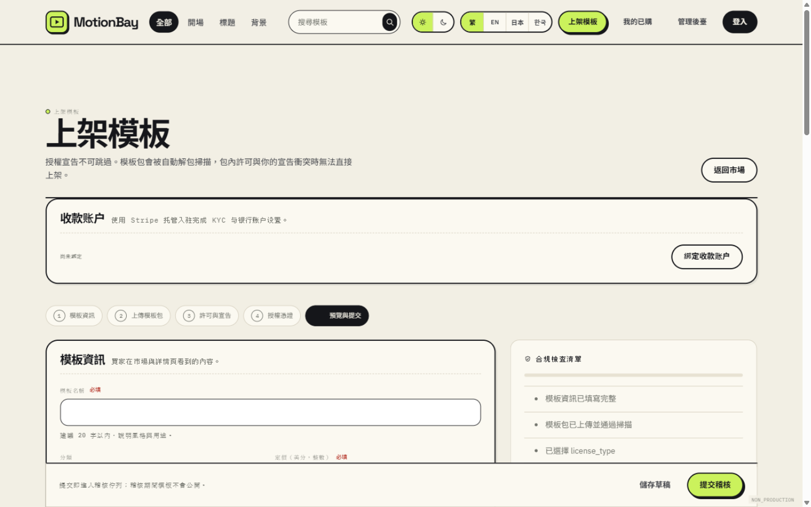
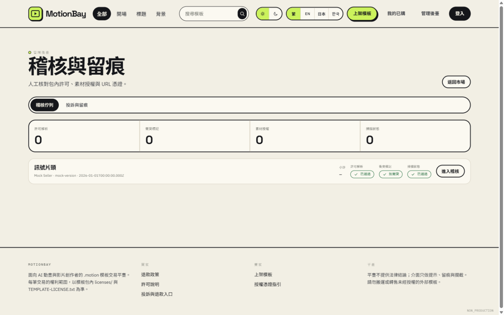

# Digital Sales Platform

**Languages:** [English](README.md) · [繁體中文](README.zh-TW.md) · [日本語](README.ja.md) · [한국어](README.ko.md)

An open-source marketplace platform for selling any digital product: design templates, motion and animation packs, presets, LUTs, plugins, 3D assets, fonts, audio, e-books, courses, and software licenses.

Built with React, Fastify, SQLite, and TypeScript. The bundled `.motion` animation template is a working reference demo, not a limitation — the same publishing, review, payment, entitlement, and private-download pipeline applies to any downloadable digital good.





## What you can sell

The listing, licensing, moderation, checkout, entitlement, and download layers are product-agnostic. You can use this template for:

- Motion graphics, animation presets, and video templates
- Design systems, UI kits, and presentation templates
- Plugins, scripts, and developer tools
- 3D models, textures, and game assets
- Fonts, sound effects, music packs, and stock media
- E-books, courses, and other downloadable knowledge products

Each product is published as a versioned package with its own license terms, preview assets, moderation record, and private delivery artifact.

## Features

### Product publishing and review

- Seller upload workflow for any packaged digital product, including `.motion` and ZIP packages.
- ZIP central-directory safety checks.
- Path traversal, absolute path, alias, duplicate entry, symlink, special-file, executable, and script detection.
- Worker-based scanning with size and timeout limits.
- Package license parsing and conflict detection.
- Seller license proof and URL evidence workflow.
- Preview asset review.
- Moderator approval gate based on scan, license, proof, preview, version, and artifact state.

### Secret scrubbing

- Text-only secret scanning.
- Bounded scan size and timeout.
- High-risk credential blocking.
- JSON-preserving secret replacement.
- Sanitized delivery ZIP generated separately from the original quarantine upload.
- Secrets are replaced with `[REDACTED_BY_PLATFORM]`.

### Stripe Connect

- Stripe Accounts v2 seller onboarding.
- Express Dashboard onboarding flow.
- Connect account idempotency.
- Connect webhook signature verification.
- Seller onboarding status synchronization.

### Checkout and payment fulfillment

- Server-side license pricing.
- Stripe Checkout Sessions for one-time payments.
- Stripe dynamic payment methods.
- Stripe Tax `automatic_tax`.
- Separate Stripe Checkout and Connect webhook secrets.
- Raw-body Stripe webhook signature verification.
- Idempotent payment event inbox.
- Duplicate event protection.
- Payment amount, currency, metadata, and PaymentIntent validation.
- Atomic order fulfillment and entitlement creation.

### Entitlements and private downloads

- Buyer-scoped entitlement library.
- Ten downloads per entitlement.
- 365-day entitlement expiry.
- Five-minute HMAC-signed download reservations.
- Idempotent download reservation keys.
- Single-use token consumption.
- Atomic download counter updates.
- Concurrent redemption protection.
- Private storage keys are never exposed to clients.
- Delivery artifact size and SHA-256 verification.
- Download responses return the sanitized ZIP only.

## Interface languages

The web interface ships with four locales:

| Code | Language |
| --- | --- |
| `zh-TW` | 繁體中文 |
| `en` | English |
| `ja` | 日本語 |
| `ko` | 한국어 |

To add another language, extend `apps/web/src/lib/i18n/strings.ts` and register the locale code in `apps/web/src/lib/i18n/i18n.ts`. Seller-provided product content and license terms are shown as entered and are not machine-translated.

## Tech stack

TypeScript · React · Vite · Fastify · SQLite (WAL) · Kysely · Stripe Checkout and Connect · Node.js 24

## Project status

### Completed

- **M0**: SQLite schema, repositories, authentication, sessions, CSRF protection, refund policy snapshots, and application guards.
- **M1**: Seller upload, ZIP scanning, secret scrubbing, license parsing, proof and preview review, moderator approval, sanitized artifact generation, and public approved catalog.
- **M2**: Email verification foundation, Stripe Connect onboarding, Stripe Checkout, Stripe webhook fulfillment, payment event deduplication, entitlements, HMAC download reservations, concurrency-safe download consumption, and real sanitized ZIP delivery.

### Not implemented

M3 administrative and financial operations are intentionally not included in this template:

- Production email provider integration.
- Refund approval workflow and Stripe Refund API integration.
- Administrative one-click takedown workflow.
- Seller revenue and settlement dashboard.
- Additional production operations, reporting, and accounting controls.

These features are left for downstream projects to design and implement according to their own business, legal, tax, and accounting requirements.

## Requirements

- Node.js 24 LTS.
- npm.
- Native build support for `better-sqlite3` and `argon2`.
- Stripe CLI for local webhook testing.
- A Stripe test-mode account for Checkout and Connect integration.

## Installation

```bash
npm ci
```

Create a local environment file:

```bash
cp .env.example .env
```

On PowerShell:

```powershell
Copy-Item .env.example .env
```

Do not commit `.env`.

## Database migration

Run the SQLite migrations:

```bash
npm run db:migrate
```

The default local database path is `./var/motion-market.db`. SQLite WAL sidecar files are created next to the database and are ignored by Git.

## Local development

Start the API and frontend together:

```bash
npm run dev
```

Services:

- Frontend: <http://localhost:5173>
- API health check: <http://127.0.0.1:3000/health>

The Vite development server proxies `/api` requests to the local Fastify API.

To start them separately:

```bash
npm run dev:api
npm run dev:web
```

The default configuration uses the real API with `USE_FIXTURES=false`. Fixtures are intended only for local presentation and tests:

```bash
USE_FIXTURES=true npm run dev:web
```

PowerShell:

```powershell
$env:USE_FIXTURES='true'
npm run dev:web
```

## Stripe CLI webhook testing

Set a Stripe test secret in `.env`:

```dotenv
STRIPE_SECRET_KEY=sk_test_...
```

Start the API, then run:

```bash
stripe listen --forward-to localhost:3000/api/v1/webhooks/stripe
```

Copy the `whsec_...` signing secret printed by the CLI into `STRIPE_WEBHOOK_SECRET`, then restart the API. Connect onboarding webhook testing uses its separate `STRIPE_CONNECT_WEBHOOK_SECRET` and the Connect webhook route:

```bash
stripe listen --forward-to localhost:3000/api/v1/webhooks/stripe/connect
```

Use Stripe test cards only during local development. Stripe Tax is enabled in Checkout, but actual calculation depends on the Stripe account's Tax settings, product tax configuration, customer location, and active tax registrations. A zero tax result does not prove tax configuration is complete.

See [REAL_STRIPE_TESTING.md](REAL_STRIPE_TESTING.md) for the short test-mode setup guide.

## Verification

```bash
npm run typecheck
npm test
npm run build
```

Start the compiled API with:

```bash
npm start
```

The compiled API serves the backend only. Serve `dist/web` through a static web server or reverse proxy.

## Security warning

This repository is an application template, not a complete production deployment. Before deploying to production:

- Configure a real transactional email provider.
- Use Stripe Live mode only after completing business, tax, and webhook configuration.
- Use HTTPS everywhere.
- Replace development session and CSRF secrets with independently generated secrets.
- Keep private storage outside the public web root.
- Restrict database and private storage filesystem permissions.
- Configure backups, monitoring, rate limits, and incident response.
- Review tax, refund, copyright, licensing, and marketplace obligations with qualified professionals.
- Do not execute uploaded package code or expose permanent private storage URLs.
- Do not commit `.env`, databases, uploads, proof files, ZIP packages, logs, or generated build output.

## Architecture

- `apps/api`: Fastify API, SQLite migrations, repositories, scanning, payments, entitlements, and private storage.
- `apps/web`: React frontend and presentation layer.
- `packages/shared`: shared domain contracts, schemas, enums, and time/money utilities.
- `tests`: M0, M1, M2, repository, and frontend contract tests.
- `docs`: architecture and API notes.
- `fixtures`: non-production presentation fixtures only.

## License

This project is released under the MIT License. See [LICENSE](LICENSE).
